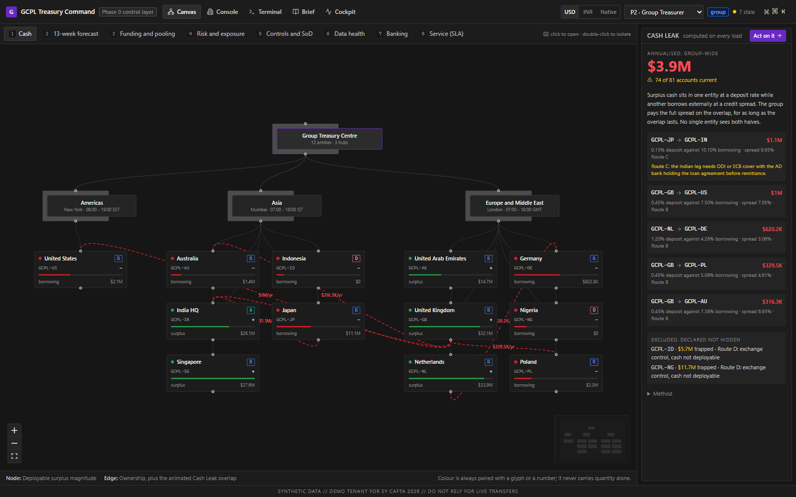
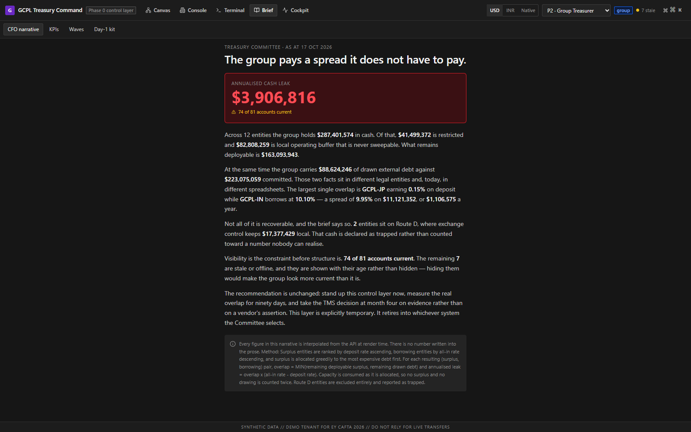
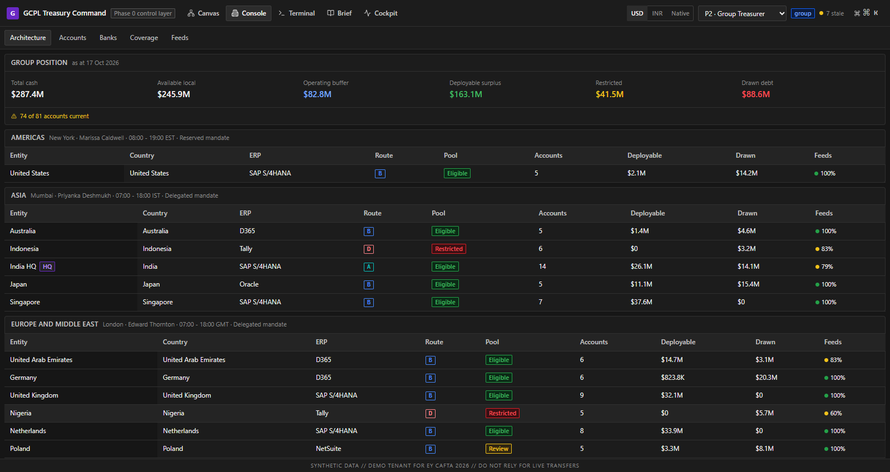
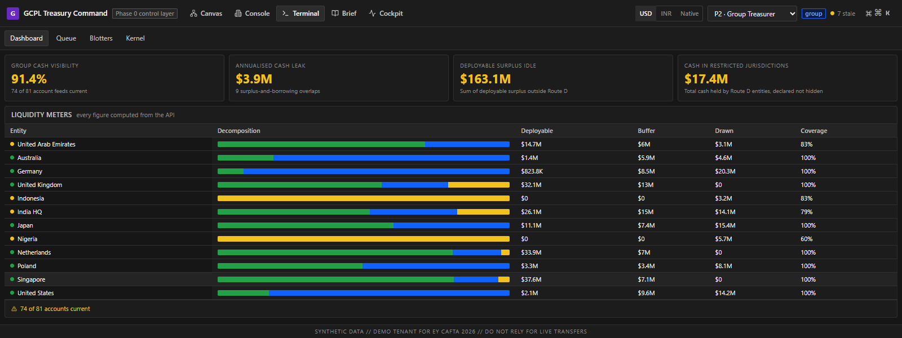
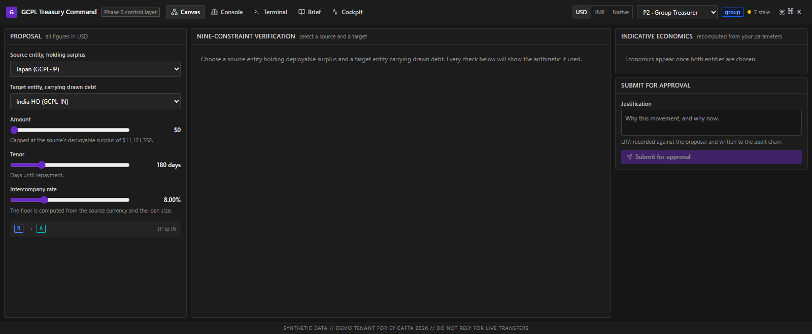

<div align="center">

<h1>GCPL Treasury Command</h1>

**The future-state treasury operating model of Global Consumer Products Ltd, rendered executable.**

A Phase 0 control layer that gives a CFO group-wide daily cash visibility on
normalised bank feeds, without buying anything — and then retires into whichever
vendor TMS the group selects at month four.

<p>
  
  
  
  
  
</p>

<p>
  <a href="https://gcpl-treasury-command.onrender.com"><strong>Open the live demo →</strong></a>
</p>

<sub>Hosted on a free instance that sleeps when idle; the first load after a quiet spell takes up to a minute.</sub>



<sub>The Canvas register. Red edges are the Cash Leak: surplus in one entity, external borrowing in another.</sub>

</div>

---

> [!IMPORTANT]
> **This is not a Treasury Management System and must never be described as one.**
> It initiates no payments, holds no credentials, and is not a system of record.
> Every figure it displays is synthetic, generated by a seeded script in this
> repository. Nothing here corresponds to a real balance, rate or counterparty.

---

## Contents

[The one number](#the-one-number) ·
[Run it](#run-it) ·
[What you are looking at](#what-you-are-looking-at) ·
[The generator](#what-the-generator-produces) ·
[The five registers](#the-five-registers) ·
[The four engines](#the-four-engines) ·
[Personas](#personas) ·
[Tests](#tests) ·
[Hosting](#hosting-it) ·
[Security](#security-posture)

---

## The one number

Whenever surplus cash sits in Entity X at a deposit rate while Entity Y borrows
externally at a credit spread, the group pays the full spread on the overlapping
balance for as long as the overlap lasts. That is the **Cash Leak**. It is
invisible because no single entity sees both halves.

The product's job is to make it visible, quantified, in one number, on first
load — and to be honest about the part that is not recoverable.



Not one digit of that narrative is written into the prose. Every figure is
interpolated from the API at render time, and the method — greedy allocation,
no double counting, Route D excluded and declared rather than hidden — is
stated in the footnote instead of buried. See
[decision 0001](docs/decisions/0001-cash-leak-allocation.md) for why the leak is
allocated greedily rather than summed over every pair, and why the literal
reading of the brief would have inflated it several times over.

---

## Run it

Two commands, no daemon, no container, no credentials.

```bash
# 1. Generate the dataset. The same seed always produces the same database.
python scripts/generate_data.py --seed 42

# 2a. API, in one terminal
python -m uvicorn api.main:app --reload --port 8000

# 2b. Web, in another
cd web && npm install && npm run dev
```

Then open <http://localhost:5173>.

The API reference is at `/docs`, on whichever origin you are running — the
Vite dev server does not proxy it, so in development it is
<http://localhost:8000/docs>. It is served from this repository rather than a
CDN, and it carries a persona selector: pick P5, call
`GET /api/v1/entities/GCPL-GB`, and watch the same request that returns 200 for
P2 come back 403.

<details>
<summary><strong>First-time setup</strong></summary>

<br />

```bash
python -m venv .venv
.venv/Scripts/activate          # Windows;  source .venv/bin/activate elsewhere
pip install -r requirements-dev.txt
cd web && npm install && cd ..
```

Requires Python 3.12+ and Node 20+.

</details>

---

## What you are looking at

<table>
<tr>
<td width="50%" valign="top">

**Console** — the estate, as it actually is

Twelve entities across three regions, 81 accounts, five ERPs, four banking
routes. Feed coverage is shown per entity and never rounded up: if 74 of 81
accounts are current, the headline says 74 of 81.

</td>
<td width="50%" valign="top">

**Terminal** — the operating picture

Liquidity decomposed per entity into deployable, buffer and drawn. The headline
KPIs are computed from `feed_status` alone; no visibility percentage is
hardcoded anywhere in the codebase, and a test enforces that.

</td>
</tr>
<tr>
<td valign="top"></td>
<td valign="top"></td>
</tr>
</table>

### The workbench shows its working

A proposal is not a form. Nine constraints are evaluated synchronously and none
of them short-circuits, because an approver needs every failure at once — and
each result states the arithmetic it used. A check that says only "passed"
tells an approver nothing they can defend.



Here the proposed rate clears a safe-harbour floor by 119bps, the counterparty
limit is 79.9% consumed, and two checks warn rather than block: the route needs
regulatory cover, and a feed over 24 hours old is in use. Both are surfaced to
the approver rather than suppressed — the balance still renders, with its age
attached.

---

## What the generator produces

`python scripts/generate_data.py --seed 42` writes `data/gcpl.db` and asserts
five invariants before it finishes. It exits non-zero if any fails.

| Object | Count |
|---|---|
| Regions / countries / currencies | 3 / 15 / 11 |
| Entities | 12, including 2 on Route D and 3 acquired within 24 months |
| Banks | 26, mixed tier and connectivity |
| Accounts | 81, of which 7 stale or offline and 23 restricted |
| Balances | 7,290 rows across 90 days |
| Facilities / proposals / workflows | 10 / 6 / 15 |
| Audit events | 220, in one valid hash chain from genesis |

Running it twice with the same seed produces a **byte-identical** file. There is
no call to `datetime.now()` anywhere in the generator; that is what makes the
demo reproducible.

---

## The five registers

| Route | Register | What it is for |
|---|---|---|
| `/canvas` | **Canvas** | One node graph, re-read through eight lenses. The Cash Leak edge animates here |
| `/canvas/pooling` | **Pooling Workbench** | Nine-constraint verification, live, with the arithmetic shown |
| `/canvas/workflow/:id` | **Workflow Studio** | Seven swimlanes, fifteen workflows, LR1–LR16 on every change |
| `/console` | **Console** | Estate architecture, the 81-account register, bank panel, coverage grid, feeds |
| `/terminal` | **Terminal** | Liquidity meters, work queue, blotters, kernel log with chain verification |
| `/brief` | **Brief** | CFO narrative, nine KPI posters, wave tracker, Day-1 kit |
| `/cockpit/:id` | **Cockpit** | A single entity's own view, including what the group sees about it |

Switching register preserves the active entity, filters and persona. Every
stateful view is deep-linkable, because treasury users paste views to approvers.

---

## The four engines

**Pooling constraints** (`api/services/pooling.py`) — nine checks, evaluated
synchronously, never short-circuiting, because the user needs every failure at
once. Each result states the arithmetic it used.

**Segregation of duties** (`api/services/sod.py`) — LR1 to LR16. Rules are rows
in `sod_rule`, not branches in the code: adding a rule means adding a row.
W7 and W12 ship with deliberate defects so the linter has something real to find.

**ABAC** (`api/services/abac.py`) — scope is resolved from persona attributes in
the repository layer, so no endpoint can forget it. A test enumerates the route
table and fails if one does.

**Audit chain** (`api/services/audit.py`) — SHA-256, append-only. There is no
update or delete path anywhere in the codebase, which is what makes verification
meaningful. Alter one row and `/audit/verify` names that exact sequence number.

---

## Personas

Ten. Send one as `X-Persona: P3` on every request; scope is resolved server-side.

| | Persona | Scope | May |
|---|---|---|---|
| P1 | CFO | Group | Approve reserved matters. Cannot execute |
| P2 | Group Treasurer | Group | Propose, approve within mandate, set limits |
| P3 | Front Office Dealer | Group | Create deals. **Cannot approve or settle** |
| P4 | Regional Lead | One region | Approve within delegated mandate |
| P5 | Local Coordinator | One entity | Submit forecasts, raise exceptions |
| P6 | Risk and Control Analyst | Group | Set limits, run the linter. **Cannot deal** |
| P7 | Operations Specialist | Group | Confirm, settle, reconcile. **Cannot initiate** |
| P8 | Internal Auditor | Group | Verify the chain. **No write access at all** |
| P9 | IT Administrator | Platform | Manage feeds. **No financial data visibility** |
| P10 | Tax and Legal Counsel | Group | Clear or block a route |

> Hiding a control in the browser is not a control. For every persona, the API
> refuses what the DOM omits, and a Playwright test asserts both halves.

Become P3, open a proposal awaiting approval, and the approve button is gone.
The point is what happens if you call the endpoint anyway: it returns 403, not
a filtered 200. An out-of-scope entity is refused by the server, never trimmed
by the browser.

---

## Tests

```bash
python -m pytest                  # 112 backend
cd web && npm test                #  31 frontend unit
cd web && npm run e2e             # 138 end-to-end, three viewport widths
```

Three of these matter more than the rest:

- `test_no_hardcoded_numbers` greps the source for percentage literals, currency
  symbols and thousands separators outside `lib/format.ts`. v1 shipped four
  contradictory figures because none of them came from the data.
- `test_every_endpoint_declares_the_scope_dependency` walks the live route table.
- `nothing animates a layout property` asserts the motion rules hold in the
  rendered page, not just in review.

---

## Hosting it

The app and the API ship as **one image on one origin**. The client calls
`/api/v1` as a relative path and the CSRF guard is a double-submit cookie pair,
so splitting them across two hosts would require a cross-origin credentialled
fetch and a `SameSite=None` cookie for no gain. FastAPI serves the built bundle
at the root; `web/dist` is absent in development, so the mount is skipped and
nothing about the two-command workflow above changes.

```bash
# Build the image exactly as the platform will.
docker build -t gcpl-treasury-command .
docker run --rm -p 8000:8000 gcpl-treasury-command   # http://localhost:8000
```

The image builds the app, seeds the canonical `--seed 42` dataset at build
time, and runs as a non-root user. The generator asserts INV-1 through INV-3
and exits non-zero, so a broken invariant fails the build rather than reaching
a judge.

**Render** is set up as a blueprint: push to `master`, point Render at
`render.yaml`, and it builds the Dockerfile and redeploys on every push. The
same image runs unchanged on Railway, Fly.io or a Hugging Face Docker Space —
`$PORT` is read from the environment, defaulting to 8000.

| Variable | Deployment value | Why |
|---|---|---|
| `GCPL_ENV` | `dev` | Writes stay open. There is no sign-in screen in `web/src`, and the persona switcher *is* the demonstration. ABAC and capability rules are enforced either way |
| `GCPL_FORCE_HTTPS` | `true` | Sends HSTS and redirects plain HTTP. `/health` is exempt so a platform probe cannot loop |
| `GCPL_SESSION_SECRET` | generated | Otherwise random per boot |
| `GCPL_DB_PATH` | `/app/data/gcpl.db` | Set in the image |

The filesystem is ephemeral: a restart returns the demo to the seeded state,
which is what you want for a link strangers can write to.

`/docs` is open on the deployment and closed when `GCPL_ENV=prod`, exactly as
FastAPI's own page was. It loads nothing from a third-party host, so it works
behind the same policy as the rest of the application.

> [!NOTE]
> SQLite and a hash-chained audit trail need one durable writer. That rules out
> serverless platforms whose instances are ephemeral and fan out per request:
> two clicks could land on different instances and fork the chain, and the
> product's own verifier would then correctly report it broken. See
> [decision 0007](docs/decisions/0007-one-origin-and-two-content-security-policies.md).

---

## Security posture

The data is synthetic, but the deployment story is part of the recommendation,
so the controls are real:

- ABAC server-side only; 403 for out-of-scope, never a filtered 200
- Signed `HttpOnly`, `SameSite=Strict` session cookie and double-submit CSRF,
  enforced when `GCPL_ENV=prod`, open in dev so the demo stays two commands
- Rate limiting on every write, in both environments
- Two content security policies: `default-src 'none'` for the API, which embeds
  nothing, and a `'self'` policy for the document that has to load its own bundle
- Security headers on every response, including errors; API figures are
  `no-store`, so they never reach a shared cache
- Exact CORS origins; never a wildcard
- No secret in the repository. `.env` is gitignored; see `.env.example`
- No full account number reaches the database, and a test enforces it

See [decision 0005](docs/decisions/0005-security-posture.md) for the reasoning,
including why authentication is conditional rather than always-on.

---

## Repository layout

```
api/          FastAPI. routers → repositories (scope) → services (engines) → models
scripts/      The deterministic generator and its static reference tables
web/src/      React 19, TypeScript strict. registers/ features/ components/ lib/
docs/         PRD.md (the spec), DESIGN.md (the design contract), decisions/ (ADRs)
data/         Generated. Gitignored.
```

Non-obvious choices are written down rather than defended from memory:

| | Decision |
|---|---|
| 0001 | [The Cash Leak is allocated greedily, not summed over all pairs](docs/decisions/0001-cash-leak-allocation.md) |
| 0002 | [Persona switching and authentication](docs/decisions/0002-persona-switching-and-authentication.md) |
| 0003 | [The settled-by column](docs/decisions/0003-settled-by-column.md) |
| 0004 | [Currency grouping follows the currency](docs/decisions/0004-currency-grouping-follows-the-currency.md) |
| 0005 | [Security posture](docs/decisions/0005-security-posture.md) |
| 0006 | [The motion system](docs/decisions/0006-motion-system.md) |
| 0007 | [One origin, and two content security policies](docs/decisions/0007-one-origin-and-two-content-security-policies.md) |
| 0008 | [The API reference page is served from this origin](docs/decisions/0008-the-api-reference-page-is-served-from-this-origin.md) |

---

## Credits

Built by **Chirantan Shalya**, **Narayan Jaiswal** and **Laavanya** for the
EY CAFTA 2026 case championship.

Bank names are real, because bank panels are public. Every company, person and
financial figure is invented.
